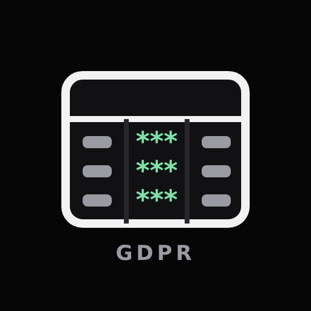

# GDPR Privacy Scanner

**Is there personal data in your dataset?** An AI-agent skill for Claude Code, Codex, Cursor and Gemini CLI that finds personal
data in datasets and code before you build AI or analytics on them, pseudonymises it on a copy and writes a short GDPR report.

**[Get it on Agensi ($15)](https://www.agensi.io/skills/gdpr-privacy-scanner-find-personal-data-before-you-build-ai)** · **[Results page](https://m-shahmeer-kz.github.io/gdpr-privacy-scanner/)**

> **Not legal advice.** It can miss personal data and can flag columns that are not personal. Have your DPO or a privacy professional
> confirm the result. Pseudonymised output is still personal data under the GDPR.

This repository is the public showcase: true test results, the test data and real example reports. The skill itself is sold on Agensi.

## Tested results

| Test | Result |
|---|---|
| **Blind test 2** (v1.1.0 frozen; 20 tables, 280 columns, 16 languages, built by a fresh AI agent that never saw the scanner) | **130/164** personal-data columns found (79%), **8/116** false alarms |
| Blind test 1 (v1.0.0 / v1.0.1; 18 tables, 256 columns) | 94/139 and 96/139 found, 15/117 false alarms |
| 9 real public datasets (answers written before the first run) | v1.0.0: 78/111 found, 28/214 false alarms · after fixes (not blind): 93/111, 5/214 |
| Pseudonymising the 9 real datasets (default plan) | direct identifiers 32 → 0 columns, special categories 7 → 0, census records unique on ordinary attributes 57.3% → 1.3% |
| Leak check | 4,900 real names, e-mails, phones and addresses: none appear in any report (examples are masked) |
| 3 real open-source code projects | first version 7 findings / 1 real; after fixes 1 finding, the real one (unkeyed MD5 of users' e-mails sent to Gravatar) |

Strongest in blind test 2: national ID numbers 13/13, free text 8/8, e-mails/phones/IBANs/cards/IPs 22/23.
Weakest: special-category columns 10/19 and person-ID columns 9/17 (abbreviated or less common languages).
Every miss and false alarm is listed in [`results/`](results/) together with the test data generators and labels.

## What it does
1. Scans CSV, Excel, JSON, Parquet, SQLite and log files: names, e-mails, phones, addresses, IBANs, payment cards, 16 EU and UK national
   IDs with check digits, Article 9 special categories (health, religion, ethnic origin...), quasi-identifiers and re-identification risk.
2. Scans code: personal data in logs, sent to LLM APIs or trackers, unkeyed hashes, special-category fields in schemas, notebook outputs.
3. Plans per column: drop, pseudonymise (keyed HMAC-SHA256), generalise, mask or redact, tightening until at most 5% of records are unique.
4. Applies the plan on a copy (originals untouched, key kept separately) and re-scans the output.
5. Writes a short GDPR report and a plain-language answer: what was found, the risks, what was done, what only you can decide.

Column names are understood in 22 EU languages. Standard library only (Python 3.10+). Nothing is uploaded.

## Examples
- [`examples/chinook-ai-training/`](examples/chinook-ai-training/): a fresh AI agent preparing a real database for AI training (answer, report, plan).
- [`examples/nine-real-datasets/`](examples/nine-real-datasets/): report after scanning and pseudonymising 9 real public datasets.

Made by [Muhammad Shahmeer](https://m-shahmeer-kz.github.io/) · © 2026, all rights reserved. Not affiliated with the EDPB or any data protection authority.
